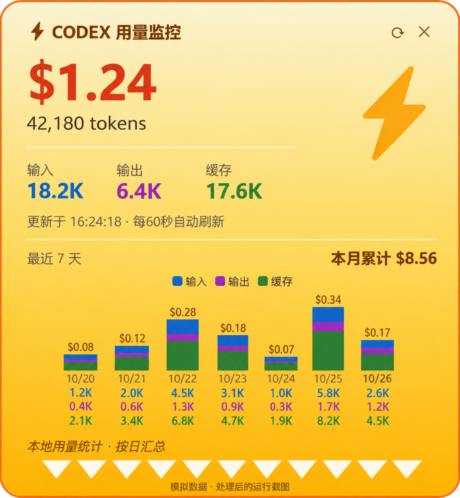

# Codex Usage Widget

一个适用于 Windows 的 Codex 用量桌面悬浮窗。由 PowerShell 和 WPF 实现，通过 [ccusage](https://github.com/ccusage/ccusage) 读取本机 Codex 会话记录的汇总结果。

> 上图基于实际运行截图制作。原角色图片已替换，费用和 Token 数值均为模拟数据；它不是未经处理的原始截图。[查看简化界面示意图](docs/preview.svg)。

## 功能

- 显示当日总 Token、输入 Token、输出 Token、缓存 Token 和估算美元费用。
- 显示本月累计估算费用，以及最近 7 天有记录日期的分类柱状图；悬停可查看每日明细。
- 显示当天使用的模型名称（取决于 ccusage 输出）、数据更新时间。
- 置顶、可拖动；打开时读取一次，之后每 60 秒刷新，也可手动刷新。
- 可选人物装饰图：将 `character.png` 或 `zenitsu.png` 放在 `widget.ps1` 同一目录，窗口会优先显示图片；没有图片时显示闪电图标。图片仅供本地使用，不包含在公开仓库中。

## 使用

1. 在 Windows 上安装 PowerShell 和 ccusage，并确保在终端中可以调用 `ccusage`。
2. 确保本机有可供 ccusage 读取的 Codex 会话记录。
3. 双击 `start.bat`，或从 PowerShell 启动 `widget.ps1`。

`start.bat` 仅对新启动的 PowerShell 进程使用 `ExecutionPolicy Bypass` 并隐藏控制台；运行前可先阅读脚本源码。这不会永久修改系统执行策略。

窗口依赖 `ccusage codex daily --since YYYYMMDD --json` 的输出。缓存栏合并显示缓存读取与缓存创建 Token；费用取自 ccusage 的估算结果，不代表官方账单。没有使用记录的日期不会出现在图表中。

## 项目说明

此仓库是个人项目的公开展示版。由于角色图片的公开分发授权不确定，仓库不包含该图片，也不包含会话日志、账号凭据或个人用量数据。

源码已做静态检查；实际运行需要上述 Windows 与 ccusage 环境。
